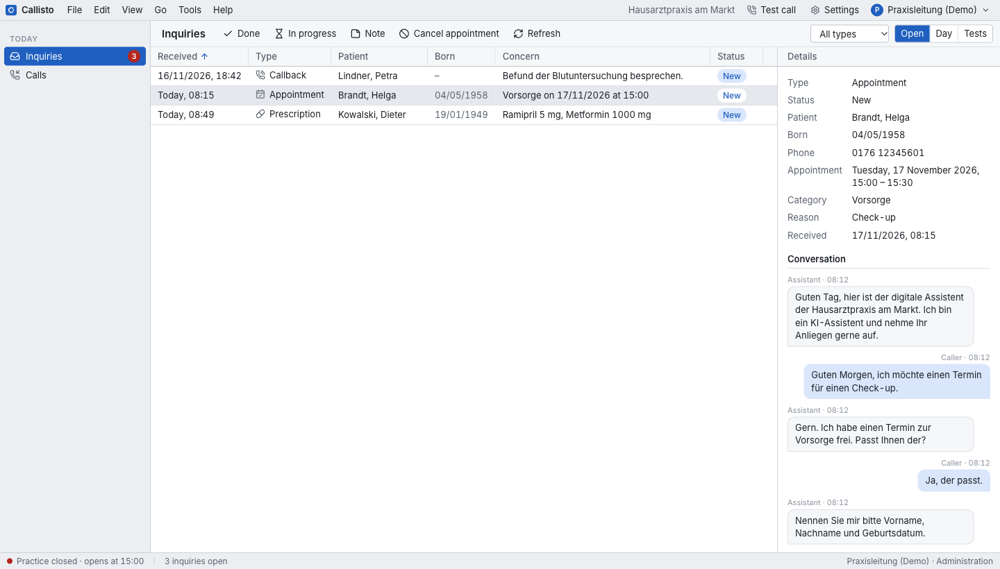
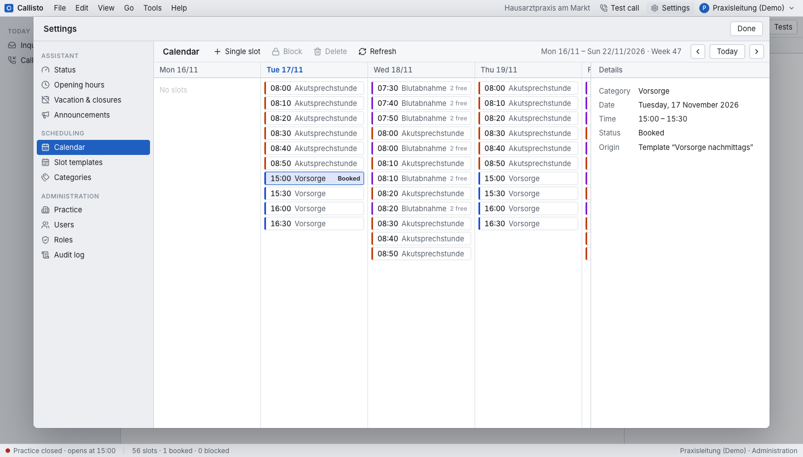
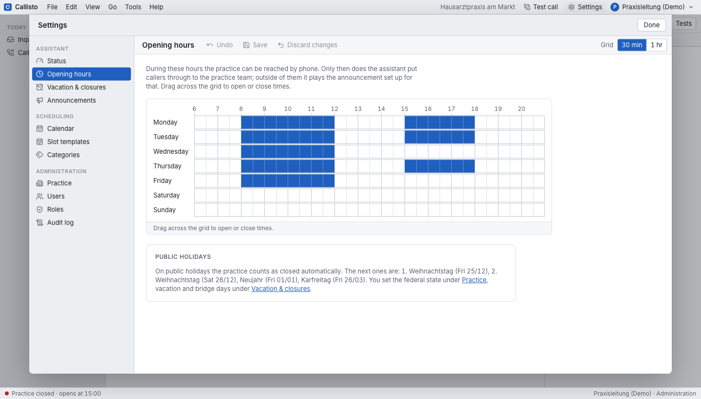

# Callisto

**English** · [Deutsch](README.de.md)

AI phone assistant for medical practices on AWS. The practice forwards its phone system to a number; the assistant books appointments and takes prescription requests, transfers other concerns to the practice, recognises emergencies and knows opening hours and vacations. The practice team sees all calls in a web app, makes appointments available for booking and configures the assistant there.

- **Deploy in a few steps:** [docs/en/quickstart.md](docs/en/quickstart.md)
- Configuration and telephony: [docs/en/configuration.md](docs/en/configuration.md)
- Architecture and decisions: [docs/en/architecture.md](docs/en/architecture.md)

## Screenshots

The daily view: open inquiries with their details and the conversation that led to them.



The calendar in the settings: the slots of a week, generated from templates, with a booked appointment selected.



The opening hours, set by dragging across a week grid in half-hour steps.



The interface is available in English and German (View → Language).

## Structure

| Folder                 | Contents                                                                                |
| ---------------------- | --------------------------------------------------------------------------------------- |
| `packages/domain`      | Business logic without AWS: schemas, opening hours, public holidays, slots, permissions |
| `packages/data`        | DynamoDB key schema and repositories                                                    |
| `services/api`         | REST API of the web app (Lambda behind API Gateway)                                     |
| `services/voice-agent` | Voice agent: conversation session, Nova Sonic, tools, test mode                         |
| `apps/web`             | Web app (React): daily view, settings, test call                                        |
| `infra`                | AWS infrastructure as a CDK app                                                         |

## Technologies

Everything is TypeScript in npm workspaces. Patient data lives in Frankfurt (`eu-central-1`), the language model runs in Stockholm (`eu-north-1`). Why each choice was made is explained in [docs/en/architecture.md](docs/en/architecture.md).

**Web app**

| Technology              | What for                                                     |
| ----------------------- | ------------------------------------------------------------ |
| React, Vite             | Single-page app, development server and build                |
| TanStack Router         | Views and URLs, including the settings sheet                 |
| TanStack Query          | Loading, caching and refreshing server data every 10 seconds |
| Hono RPC client         | Type-safe API calls using the API's own types                |
| Radix UI                | Menu bar, context menus, dialogs, toasts                     |
| react-resizable-panels  | Resizable navigation and detail pane                         |
| react-oidc-context      | Sign-in through Cognito (authorization code flow with PKCE)  |
| Web Audio, AudioWorklet | Microphone and speaker in the test call                      |
| CSS variables           | Light and dark styling                                       |

**API and business logic**

| Technology                | What for                                                                       |
| ------------------------- | ------------------------------------------------------------------------------ |
| Zod                       | Schemas for input and data, shared by the API, the web app and the voice agent |
| Hono                      | REST API, one app per area (settings, calls, users)                            |
| AWS Lambda, API Gateway   | Running the API, checking sign-in through Cognito                              |
| Amazon Cognito            | User accounts, sign-in with a two-factor code                                  |
| EventBridge Scheduler     | Generating appointment slots every night                                       |
| Powertools for AWS Lambda | Structured logs without patient data                                           |

**Voice agent**

| Technology                      | What for                                                    |
| ------------------------------- | ----------------------------------------------------------- |
| Amazon Nova 2.5 Sonic (Bedrock) | The conversation itself: speech in, speech out, tool calls  |
| Amazon Polly                    | Fixed announcements word for word (greeting, 112, farewell) |
| WebSocket (`ws`)                | Test call from the browser                                  |
| ECS Fargate                     | Always-on container for the conversations                   |

**Telephony**

| Technology                                                | What for                                              |
| --------------------------------------------------------- | ----------------------------------------------------- |
| Amazon Chime SDK (SIP Media Application, Voice Connector) | Phone number, answering and transferring calls        |
| SIP, RTP, G.711                                           | Phone line directly in the voice agent, without a PBX |

**Data**

| Technology        | What for                                                           |
| ----------------- | ------------------------------------------------------------------ |
| DynamoDB          | Two tables: planning (settings, slots, users, audit log) and calls |
| AWS KMS           | Dedicated key for the call table                                   |
| EventBridge Pipes | An event for every new inquiry, with IDs only                      |
| Secrets Manager   | Key for the test call tickets                                      |

**Infrastructure and tooling**

| Technology         | What for                                                                     |
| ------------------ | ---------------------------------------------------------------------------- |
| AWS CDK            | The entire infrastructure as code                                            |
| CloudFront, S3     | Serving the web app; routes `/v1` to the API and `/voice` to the voice agent |
| AWS WAF (optional) | Protecting the API                                                           |
| Vitest             | Tests of all workspaces                                                      |
| Biome              | Linting and formatting                                                       |

## Local development

No AWS account needed: API and voice agent run in one process on in-memory data, with a sample practice and made-up calls of the day. There is no sign-in locally; at the top right you can switch between two sample users (administration, practice team).

```sh
npm install          # dependencies of all workspaces
npm run dev:api      # API and voice agent on http://localhost:8787
npm run dev:web      # web app on http://localhost:5173
npm run check        # lint, type check and tests
```

Locally, the assistant is played by a script that understands typed keywords ("Termin", "Rezept", "Sprechzeiten" …). With `CALLISTO_MODEL=nova npm run dev:api`, the test call talks to Nova Sonic on Bedrock instead; this requires AWS credentials in the shell and model access enabled in Stockholm.

The development server also opens a phone line on `sip:praxis@127.0.0.1:5060` (SIP over UDP, G.711). A softphone such as Linphone calls there like a patient. Spoken answers require `CALLISTO_MODEL=nova`, because the script does not understand speech.

## Deploying on AWS

Step by step: [docs/en/quickstart.md](docs/en/quickstart.md).

```sh
npm run synth        # build the web app, generate CloudFormation templates
npm run diff         # difference to the deployed state
npm run deploy       # deploy all stacks
```
